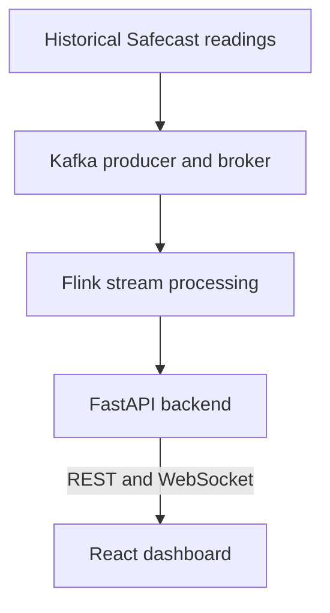

# Radiation Tracking Dashboard

**Chanakya Gummidipudi · Frontend lead for the map**  
TU Hamburg Big Data team project · April–July 2026

Our team built an interactive dashboard that replays historical Safecast radiation readings as a live event stream. Users can see where measurements were recorded, explore changes over time, and put individual readings in context with charts, summary statistics, and alerts.

## My contributions

- Built the React frontend structure and led development of the interactive Leaflet map.
- Styled map markers by radiation level and added a legend so users could interpret readings at a glance.
- Integrated REST APIs and WebSocket updates for the dashboard’s live view.
- Added time-based exploration so users could inspect how readings changed across different time windows.

## How the system worked

The producer replayed historical measurements into Kafka. Flink processed the stream, and FastAPI exposed readings and summaries to the frontend. The dashboard used React, Leaflet, and Recharts to display measurements on a map and in charts.

## A frontend design decision

The dashboard needed to show useful information as soon as someone opened it, even if the next reading hadn’t arrived. REST requests populated the initial view, then WebSocket updates refreshed it as readings arrived. REST also provided a fallback when the live connection was unavailable.

The team’s mock mode let us develop the dashboard against the backend interface while the full Kafka and Flink pipeline was being integrated.

## Team and data source

Built with Ayush Parab, Moniya Mohan, Mrudula Sachin Rothe, Roshan Srinivasan, and Roshin Roy as part of TU Hamburg’s Big Data coursework.

[Safecast radiation data](https://safecast.org/data/download/)
